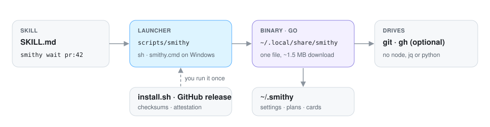

<div align="center">

# smithy

**Agent skills for planned, test-first, parallel software work.**

[](https://github.com/Zovaris/smithy/actions/workflows/check.yml)
[](https://github.com/Zovaris/smithy/releases)
[](go.mod)
[](LICENSE)

[](#skills)
[](#harnesses)
[](#harnesses)
[](#harnesses)
[](#harnesses)
[](#harnesses)

</div>

smithy turns your coding agent into a small engineering team: it plans before it builds, writes
the failing test first, checks its work with independent reviewers, runs many tasks in parallel
and keeps the pull requests green until they merge. It works in any harness that loads
`SKILL.md` skills (Claude Code, Codex, OpenCode, Cursor, Gemini, Pi,
DeepSeek Harness), and needs git. It is built for GitHub: the [GitHub CLI](https://cli.github.com) (`gh`) gives the full
experience but is optional (with `GH_TOKEN`/`GITHUB_TOKEN` smithy uses the GitHub API; with neither, it
pushes the branch and prints a compare URL to open the PR by hand).

## Quick start

```bash
npx skills add Zovaris/smithy -g
```

Pick every skill (at least `use-smithy`) and the agents to install to. Then, in your agent:

1. **"run use-smithy setup"** — models, settings, and an optional pointer in your `AGENTS.md`.
2. **Describe a task** (or start `/smelt <task>`) — planned and built test-first, ending in a PR.
3. **Hand over several tasks** (or `/warden <tasks>`) — one worker and PR each, after your yes.

## How it works


- **use-smithy** is loaded by the agent on its own and routes each piece of work to the skill that
  fits.
- **smelt** and **warden** share one task list (`NN-<slug>.md` files with status, blockers and PR),
  in the repo or in `~/.smithy/plans/`. Plan with smelt, build one task at a time or hand the list
  to warden.
- **Proof, not claims:** every "tests pass" is a recorded receipt (`smithy receipt`) pasted into
  the PR, and `smithy scan` checks the change for secrets before anything is pushed.
- **tend** keeps every open PR green: CI fixes, rebases after sibling merges, review threads.
- **It learns, with your yes:** after a PR, smelt proposes up to 3 lessons, each citing evidence
  (a receipt, a failing test, a review finding); warden's final message lists the decisions it
  made alone. What you accept lands in `docs/agents/STANDARDS.md` or `scripts/SCRIPTS.md`, which
  every later session and worker reads first. ledger keeps both small: a rule budget, and lines
  whose files are gone are retired (`smithy drift` flags them).
- **You decide** the plan, scope, and merges: nothing reaches the production branch without your
  explicit yes. Agents work silently and send their questions up to the session you talk to.
- Commits are atomic in your repo's style, PRs follow your template, branches are named
  by `smithy names branch` (`feat/…`, `fix/…`), and finished worktrees are removed every time.

## Skills

| Skill | Started by | What it does |
|---|---|---|
| [use-smithy](skills/use-smithy/README.md) | the agent | Routes work to the installed skills and holds the shared rules. **Install it.** |
| [smelt](skills/smelt/README.md) | you or the agent · `/smelt` | One task, step by step: brainstorm, spec, TDD, test agents, review, receipts, secret scan, PR. `fast`, `normal` or `full` (adds a hostile run of the built system). |
| [warden](skills/warden/README.md) | you or the agent, after your yes · `/warden` | Many tasks in parallel: one silent worker and worktree per task, each to its own PR. |
| [tend](skills/tend/README.md) | you · `/tend`, or smelt and warden | Keeps PRs mergeable: CI, rebases, review comments; can watch the repo: new PRs, labeled issues, red workflow runs, base moves, Dependabot alerts. |
| [ledger](skills/ledger/README.md) | the agent or you | ADRs, glossary, standards, scripts index, module READMEs, codebase map, doc drift, comment policy. |
| [scout](skills/scout/README.md) | the agent or you | Read-only answers with sources, on your cheap model. |
| [hush](skills/hush/README.md) | you or the agent · `/hush` | Does the task with no talk; ends with one `done:` line. |
| [simple](skills/simple/README.md) | the agent | Short, plain replies with no filler. Off with "normal mode". |

## Harnesses

Nothing depends on one vendor. What changes per harness is how you start a skill, how warden
starts workers and whether a waiting session can be woken up:

| Harness | Skills folder (global) | Start a skill | Warden workers | Wake on background exit |
|---|---|---|---|---|
| Claude Code desktop | `~/.claude/skills` | `/smelt` | app sessions (`start_session`) | yes |
| Claude Code CLI | `~/.claude/skills` | `/smelt` | `claude --bg` | yes |
| Codex CLI | `~/.agents/skills` | `$smelt` | `smithy agent` → `codex exec` | no: foreground watcher |
| OpenCode | `~/.config/opencode/skills`, `~/.agents/skills` | `@smelt` | `smithy agent` → `opencode run --standalone` | yes |
| Pi | `~/.pi/agent/skills`, `~/.agents/skills` | `/skill:smelt` | `smithy agent` → `pi -p` | no: foreground watcher |
| DeepSeek Harness | `~/.dsh/skills`, `~/.agents/skills` | `/smelt` | `smithy agent` → `dsh headless` | yes |
| Gemini CLI | `~/.gemini/skills`, `~/.agents/skills` | ask: "use smelt" | `smithy agent` → `gemini -p` | with `backgroundCompletionBehavior: inject` |
| Cursor CLI | `~/.cursor/skills`, `~/.agents/skills` | `/smelt` | `smithy agent` → `agent -p` | no: foreground watcher |

`smithy agent` runs workers headless with each CLI's flags for writing files, running commands
and opening PRs without prompts (`AGENT_CLI` picks one, `AGENT_ARGS` adds flags, `AGENT_CMD`
plugs in anything else). Every skill can be run by an agent; only warden is kept out of implicit
invocation (`allow_implicit_invocation: false` in `skills/warden/agents/openai.yaml` for Codex), and it still
asks for a yes before it starts sessions.

## The smithy binary



Everything mechanical (settings, branch names, task lists, status cards, commits and PRs in your
repo's style, waiting on CI) is one small Go binary, `smithy`. You never install it: each skill
ships a launcher that downloads the binary for your platform from the matching release the first
time it runs, verifies its checksum and its GitHub build attestation (with `gh`), and caches it
in `~/.smithy/bin/`. Without `gh` it downloads with `curl`, verifies the checksum only and prints
a warning (install the GitHub CLI to verify the build's origin); a mismatch refuses. A `gh`
too old for `gh attestation` still refuses unless you set `SMITHY_ALLOW_UNATTESTED=1`. Agents wait on GitHub without
spending tokens:

```bash
smithy wait pr:42                 # checks finished (with failed names), merged, closed, conflict, review
smithy wait run:123 branch:main   # a workflow run, or every run on the branch's latest commit
smithy wait watch:all             # PRs, issues, red runs, base moves, alerts
smithy status                     # every task list and warden batch on this machine
smithy receipt run -- go test ./... # record a verify run (exit, output digest, commit) for the PR
smithy scan                       # keys, tokens and secret files in what the change adds
```

To use `smithy` in your own terminal, accept the PATH offer in use-smithy setup (on Windows, add
`%USERPROFILE%\.smithy\bin` to your user PATH). `smithy --help` lists every command.

## Settings

Two JSON files, the repo's first: `<repo>/.smithy/config.json` and `~/.smithy/config.json`. You
never edit them by hand: use-smithy setup asks everything up front, or each skill asks the first
time it needs a value. `smithy config list` shows every setting and where it came from; all of
them, with defaults, are in [docs/settings.md](docs/settings.md).

## Install options

```bash
npx skills add Zovaris/smithy -g -y --skill '*' -a claude-code -a codex   # no prompts
npx skills add Zovaris/smithy@v0.10.0 -g                                   # pin a release
npx skills update -g                                                      # update
```

Drop `-g` to install into the current project only. Requires the
[skills CLI](https://github.com/vercel-labs/skills) (Node 22.20+) and git;
[`gh`](https://cli.github.com) signed in is recommended, not required.

## Roadmap

smithy is GitHub-only today. Other forges (GitLab, Bitbucket) come later; there is no `glab`
support now.

## Contributing

See [CONTRIBUTING.md](CONTRIBUTING.md). One version for the whole repo, tagged `vX.Y.Z` with a
GitHub release; changes are in [CHANGELOG.md](CHANGELOG.md).

## Credits

Ideas borrowed from [firstmate](https://github.com/kunchenguid/firstmate),
[dsh-superagent-prototype](https://github.com/deepseek-ai/dsh-superagent-prototype),
[mattpocock/skills](https://github.com/mattpocock/skills),
[superpowers](https://github.com/obra/superpowers) and
[scriptify](https://github.com/pfcoperez/scriptify).

## License

[MIT](LICENSE)
