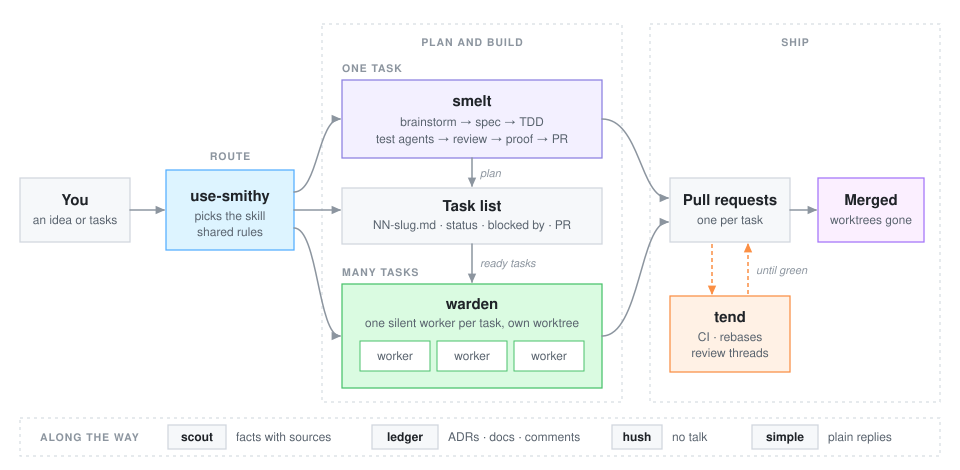
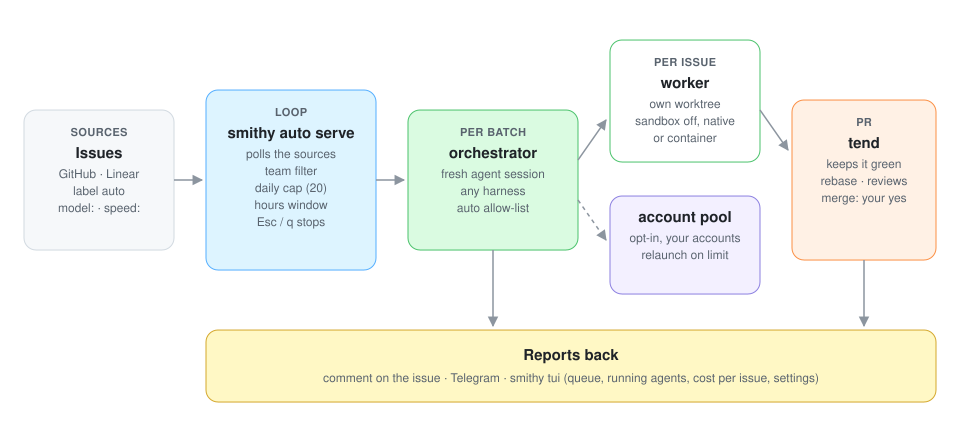
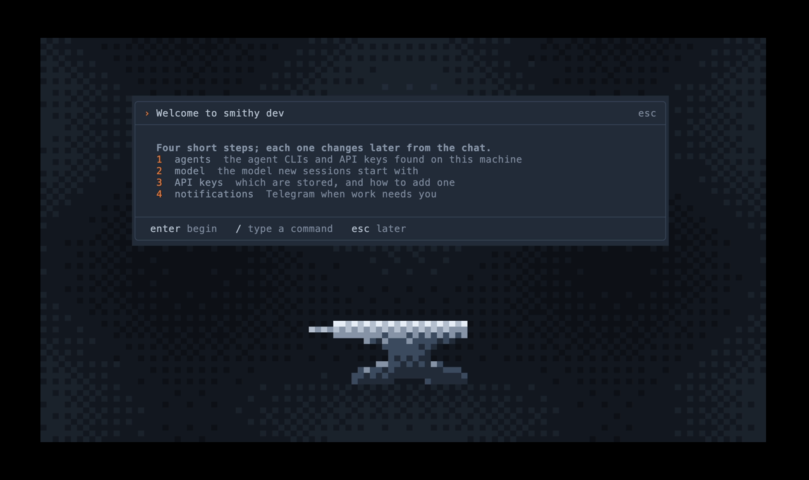
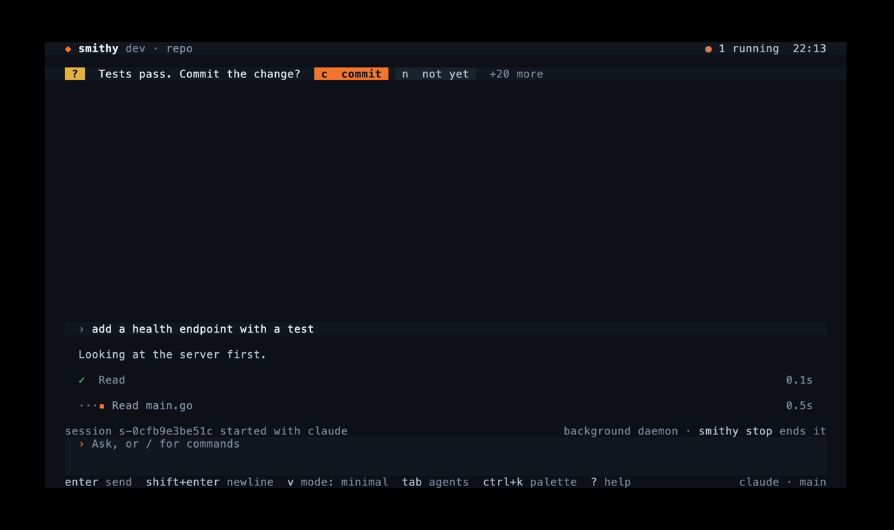
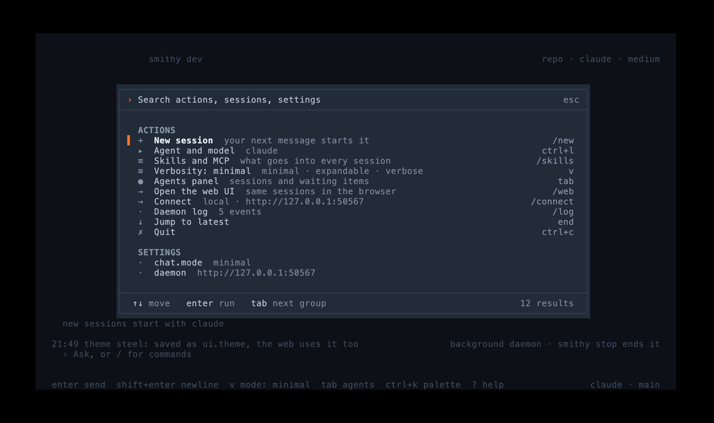
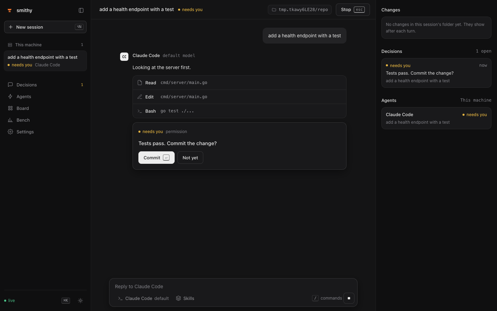

<div align="center">

# smithy

**Agent skills for planned, test-first, parallel software work.**

[](https://github.com/Zovaris/smithy/actions/workflows/check.yml)
[](https://github.com/Zovaris/smithy/releases)
[](go.mod)
[](LICENSE)

[](#skills)
[](#harnesses)
[](#harnesses)
[](#harnesses)
[](#harnesses)
[](#harnesses)
[](#harnesses)
[](#harnesses)

[Usage](#usage) · [How it works](#how-it-works) · [Skills](#skills) ·
[Autonomous mode](#autonomous-mode) · [Harness](#harness) · [Docs](#docs)

</div>

smithy turns your coding agent into a small engineering team: it plans before it builds, writes
the failing test first, runs tasks in parallel and keeps every pull request green until it merges.

> **If you are an AI agent:** read [docs/agents.md](docs/agents.md). In short:
> 1. install the skills with `npx skills add Zovaris/smithy -g -y --skill '*' -a <harness>`;
> 2. ask the user before running `install.sh`, and run it only on their yes;
> 3. run use-smithy setup with the user.

## Highlights

- **Plans first.** Brainstorm, spec and a task list before any code.
- **Test-first.** Every change starts from a failing test.
- **Proof, not claims.** "Tests pass" is a recorded receipt in the PR, and secrets are scanned before every push.
- **Parallel.** Many tasks at once, one worktree and one PR each.
- **PRs stay green.** CI fixes, rebases and review threads are handled for you.
- **You decide.** Nothing reaches production without your yes.
- **Learns with your yes.** Lessons backed by evidence go into your repo's standards.
- **Runs unattended.** Label an issue `auto` and it gets built.
- **Any harness.** Claude Code, Codex, OpenCode, Cursor, Antigravity CLI, Copilot CLI, Grok Build, Pi and DeepSeek Harness.

## Usage

### Install

```bash
curl -fsSL https://raw.githubusercontent.com/Zovaris/smithy/main/install.sh | sh
```

This downloads the `smithy` binary, checks its checksum and build attestation, and copies the
skills into every agent it finds. No Node needed.

- Binary only: `curl ... | sh -s -- --no-skills` (add the skills later with `smithy skills install`).
- Pin a version: `curl ... | sh -s 0.23.1`.
- The binary lands in `~/.local/bin/smithy`. If that folder is not on PATH, the script prints the line to add.
- Requires git. The attestation check needs [`gh`](https://cli.github.com); without `gh`, PRs fall
  back to `GH_TOKEN` or a compare URL.

Then, in your agent:

1. **"run use-smithy setup"** to choose models and settings.
2. **Describe a task** (or `/smelt <task>`): it gets planned, built test-first and opened as a PR.
3. **Hand over several tasks** (or `/warden <tasks>`): you get one worker and one PR for each.

### Update

```bash
smithy update            # binary and skills to the latest release
smithy update --check    # compare versions, change nothing
smithy update 0.23.1     # a specific version
```

Rerunning the installer with `sh -s -- --update` does the same.

### Uninstall

```bash
smithy uninstall
```

It lists what it removes, then asks: the binary, the skills it installed, a running daemon and the
PATH line it added. Your keys and settings in `~/.smithy` stay unless you pass `--purge`.

More options: [docs/install.md](docs/install.md).

## How it works



| Step | What happens |
|---|---|
| **Route** | use-smithy picks the right skill for each request |
| **Plan** | smelt writes a task list (`NN-<slug>.md`) shared with warden |
| **Build** | one task with smelt, or many in parallel with warden |
| **Prove** | `smithy receipt` records test runs; `smithy scan` blocks secrets |
| **Keep green** | tend fixes CI, rebases and answers reviews |
| **Learn** | up to 3 lessons per PR, each with evidence, kept only on your yes |

## Skills

| Skill | What it does |
|---|---|
| [use-smithy](skills/use-smithy/README.md) | Routes work to the other skills. **Install it.** |
| [smelt](skills/smelt/README.md) | One task end to end: spec, TDD, review, PR |
| [warden](skills/warden/README.md) | Many tasks in parallel, one worker and PR each |
| [tend](skills/tend/README.md) | Keeps PRs mergeable and watches the repo |
| [ledger](skills/ledger/README.md) | ADRs, glossary, standards and doc drift |
| [scout](skills/scout/README.md) | Read-only answers with sources |
| [hush](skills/hush/README.md) | Does the task with no talk |
| [simple](skills/simple/README.md) | Short, plain replies |

## Autonomous mode

Label an issue `auto` on GitHub or Linear, and smithy builds it unattended and reports back.



```bash
smithy config set auto.sources github,linear
smithy auto serve      # Esc/q stops it
smithy tui             # queue, running agents, cost, settings
```

The spend is bounded by a daily cap and an hours window. Workers can run in a sandbox, and an
opt-in pool spreads the work across your own accounts. Read
[docs/autonomous.md](docs/autonomous.md) before running it: issue text can carry injected
instructions.

## Harnesses

| Harness | Start a skill | Warden workers |
|---|---|---|
| Claude Code (desktop, CLI) | `/smelt` | app sessions, `claude --bg` |
| Codex CLI | `$smelt` | `codex exec` |
| OpenCode | `@smelt` | `opencode run` |
| Cursor CLI | `/smelt` | `agent -p` |
| Antigravity CLI (`agy`) | "use smelt" | `agy -p` |
| GitHub Copilot CLI | "use smelt" | `copilot -p` |
| Grok Build | "use smelt" | `grok -p` |
| Pi | `/skill:smelt` | `pi -p` |
| DeepSeek Harness | `/smelt` | `dsh headless` |

Skills folders, background behavior and custom agents: [docs/harnesses.md](docs/harnesses.md).

## The smithy binary


One small Go binary does the mechanical work: settings, branch names, task lists, commits, PRs and
waiting on CI without spending tokens.

```bash
smithy wait pr:42                    # until checks finish, merge, conflict or review
smithy status                        # every task list and batch on this machine
smithy receipt run -- go test ./...  # record a test run for the PR
smithy scan                          # secrets in what the change adds
```

`smithy help` lists the commands by task; `smithy help <command>` shows usage, flags and
examples for one (`smithy help --all` adds the commands the skills call).

## Harness

Run `smithy` to open a chat with any agent CLI above. A local daemon runs the sessions, and the
TUI and the web are two views of it, so you can leave and come back, or open the same sessions
from your phone.

- Sessions per project; `tab` lists them.
- Modals for agent, model, skills and settings; `ctrl+k` opens the palette.
- `/name` runs any installed skill; `!cmd` runs a shell command.
- Three themes (steel, frost, plum) and a first-run welcome.
- `/detach` quits and keeps the daemon running.

| First run | Working session |
|---|---|
|  |  |
| **Palette (`ctrl+k`)** | **Same session on the web** |
|  |  |

Every key and command: [docs/harness-guide.md](docs/harness-guide.md).

## Docs

- [Install and update](docs/install.md)
- [Settings](docs/settings.md)
- [Autonomous mode](docs/autonomous.md)
- [Harnesses](docs/harnesses.md)
- [Harness guide](docs/harness-guide.md)
- [For AI agents](docs/agents.md)
- [API backend and benchmark](docs/api-backend.md)
- [Changelog](CHANGELOG.md) · [Contributing](CONTRIBUTING.md)

GitHub is the only forge today; GitLab and Bitbucket come later.

## Credits

Ideas borrowed from [firstmate](https://github.com/kunchenguid/firstmate),
[dsh-superagent-prototype](https://github.com/deepseek-ai/dsh-superagent-prototype),
[mattpocock/skills](https://github.com/mattpocock/skills),
[superpowers](https://github.com/obra/superpowers) and
[scriptify](https://github.com/pfcoperez/scriptify).

## License

[MIT](LICENSE)
