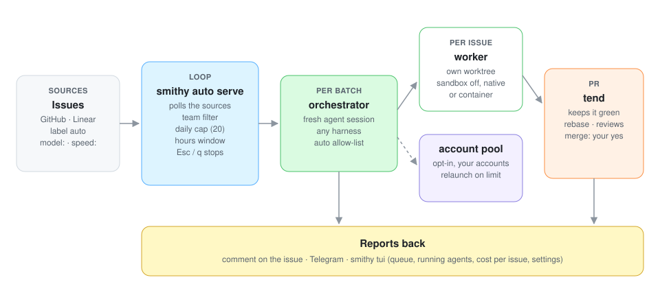

# Autonomous mode

tend `auto` watches labeled GitHub and Linear issues and builds each one unattended through
warden, reporting progress back on the issue.



## Setup

Run it under a dedicated OS user or machine (see [Security](#security)).

```
smithy config set auto.sources github,linear
smithy config set linear.team ENG              # required for Linear
smithy auth set linear < keyfile               # or LINEAR_API_KEY
smithy config set auto.max_per_day 20
smithy auto serve                              # Esc/q stops the loop; running agents keep going
```

Issues opt in with the `auto` label. `model:` and `speed:` labels pick the tier and smelt speed.
A daily cap and an optional hours window bound the spend. `smithy tui` shows the queue, running
agents and the cost of each issue, and edits settings in place. Every setting is listed in
[settings.md](settings.md).

## Notifications

```
smithy auth set telegram                       # bot token
smithy config set notify.telegram.chat <id>
smithy notify test
```

## Security

Issue text can carry injected instructions. Run unattended mode under a dedicated OS user or
machine, with a fine-grained, repo-scoped GitHub token and a test or least-privilege Linear key.

- **What each harness gets under `--profile auto`:**

  | Harness | Guard |
  |---|---|
  | Claude Code | smithy's allow-list: explicit git/gh subcommands; config edits, credential and network commands, and secret files denied |
  | Codex | its workspace-write sandbox, network on (push needs it), approvals off |
  | Others | their own headless mode, no smithy allow-list: use `container` |

  None of these removes the risk. Nothing stops Codex or the others sending data out, so
  least-privilege tokens matter most there.
- **Not sandboxed.** The orchestrator itself is not sandboxed and may run repo tests.
- **Credentials workers keep.** Workers sign commits through your ssh-agent, so use a dedicated
  signing key. They still get your `GH_TOKEN`.

### Sandbox

`auto.sandbox` is read from your user config only. It fails closed, and `smithy doctor` checks
it.

| Mode | Isolation | Works with |
|---|---|---|
| `off` (default) | the guard above only | every harness |
| `native` | the harness's own OS sandbox: writes only to the worktree and smithy's plans | Claude Code; Codex runs with network off, so push and `gh` fail; Gemini CLI is refused (its sandbox can't limit hosts) |
| `container` | docker or podman, read-only root, dropped capabilities | Claude Code, Codex, OpenCode |

Container mode notes:

- **Network:** it needs `auto.sandbox_network`. `proxy` puts workers on an internal network whose
  only exit is the `smithy-proxy` sidecar: GitHub, the model APIs, package registries and
  `auto.sandbox_domains`, nothing else. `bridge` is open egress with no domain allow-list.
- **Secrets (proxy only):** the worker never gets the key. Bind it to its host, then the worker
  calls the proxy, which adds the key and scrubs it from the response:

  ```sh
  smithy auth set linear < key.txt
  smithy auth bind linear api.linear.app GET,POST
  # inside the worker: curl http://smithy-proxy:8877/s/linear/graphql
  ```

  Writes are refused unless bound; `smithy auth ask <name> on` holds them until
  `smithy proxy approve <id>` instead. The sidecar needs a linux smithy binary
  (`auto.sandbox_proxy_binary`, see [settings](settings.md)).
- **Credentials:** each worker gets only its own harness's credential from `smithy auth`:

  | Harness | Credential |
  |---|---|
  | Claude Code | `claude` (from `claude setup-token`) or `anthropic` |
  | Codex | `openai` |
  | OpenCode | none for free models; `anthropic` or `openai` for those providers' models |

  Credentials are visible to `docker inspect` and to anyone with the engine socket.
- **User:** on macOS the container runs as root inside the engine VM; on Linux it runs as your uid.

## Account pool

The pool is off until you add an account. Each account is your own, on its harness's official CLI,
signed in once in its own config dir.

| Harness | Config dir per account | Limit detected |
|---|---|---|
| Claude Code | `CLAUDE_CONFIG_DIR` | yes |
| Codex | `CODEX_HOME` | yes |
| OpenCode | `XDG_DATA_HOME` | yes |
| Gemini CLI | `GEMINI_CLI_HOME` | yes |
| Cursor CLI | `CURSOR_CONFIG_DIR` | no |
| Pi | `PI_CODING_AGENT_DIR` | yes |
| DeepSeek Harness | `DSH_HOME` | no |

Every harness rotates across its accounts. Where the limit is not detected yet, a limited run fails
like any other error, and the next run picks the next account.

`smithy agent` picks the least recently used account that is not rate limited. When a run hits a
usage limit, that account is marked until its reset:

- **Clean run:** a read-only or untouched run reruns once on the next account.
- **Partial work:** the run stops (exit 75) and warden resumes it in the same worktree.

```
smithy pool add main <harness>       # ~/.smithy/accounts/main
smithy pool login main               # sign in once, then exit
smithy pool list                     # status, reset time, runs and cost today
smithy config set auto.agent pool    # optional: the orchestrator may use any pooled harness
```

When every account is limited, `smithy agent` exits 75 and serve waits for the earliest reset,
then notifies you on Telegram if it is set up.

Use only accounts you own, through the official CLIs, with no proxy or relay in between: each
provider's terms apply to each account.

- **Hiding the account dirs:** `native` hides them from workers. With the sandbox `off`, only
  Claude Code workers get a deny rule for them.
- **Container:** a pooled container worker mounts only its own account's dir and gets its
  config-dir variable (`CODEX_HOME`, `XDG_DATA_HOME`, ...). A claude account's Keychain login never
  reaches a container, so each needs its own token: run `claude setup-token` signed in as that
  account, then `smithy auth set claude:<account>`. `smithy doctor` fails until every claude account
  in the pool has one.
