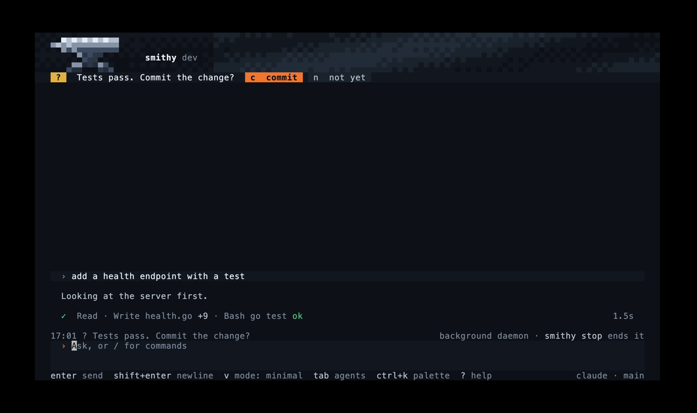
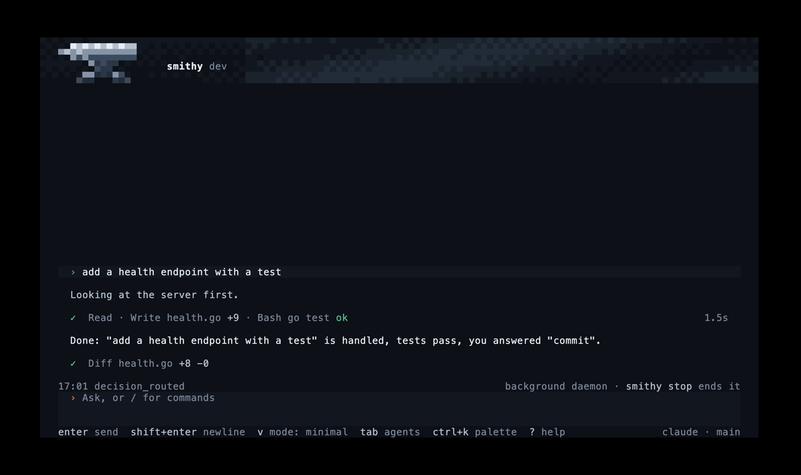
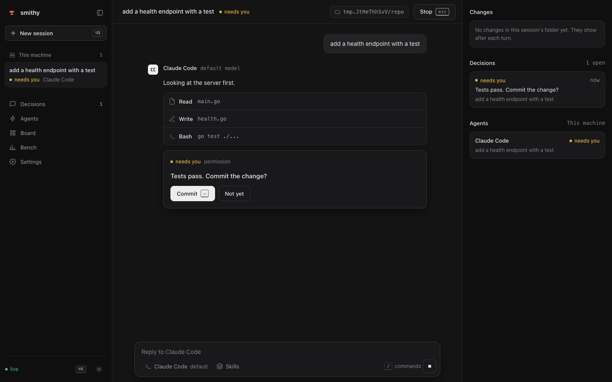
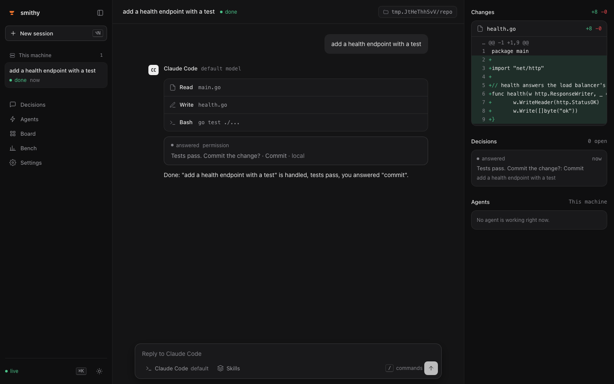
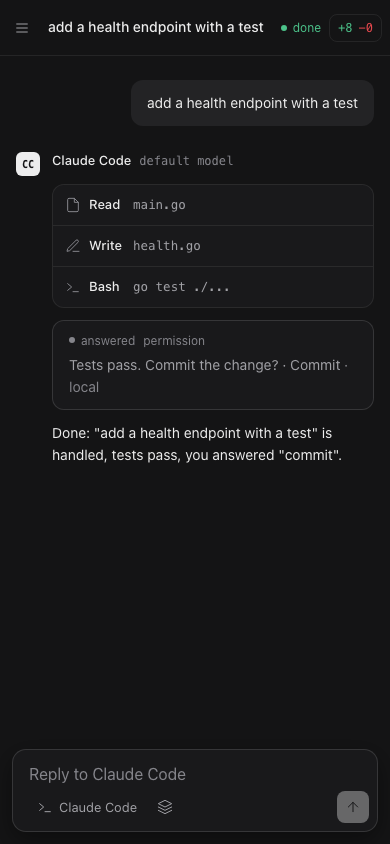

# Demo

One flow, recorded on the real binary: open smithy, first-run detection, start a session, send a
message, see the tool calls, answer the decision, then the web at phone width. `demo/run.sh`
records it on a throwaway `SMITHY_HOME` with `smithy daemon --demo`, whose sessions run a scripted
agent (a read, an edit, a test run, one decision), so it needs no agent CLI, key or network.

Every CI run of the `demo` job records it again and keeps the result as the `demo` artifact: the
TUI tape (`tui.gif`) and screenshots of each step, the first-run screens included.

## TUI

`demo/tui.tape` (VHS) types `smithy`, picks the default agent on the first-run screen, sends a
message and answers the decision with its key.

| Tool calls, decision waiting | Answered |
|---|---|
|  |  |

## Web

`web/scripts/demo-shots.mjs` (Playwright) opens `smithy web`'s URL: first run opens Settings to
pick the default agent, then a new session is started from the page, its decision answered, and
the same session shown at 390 px.

| Session, decision waiting | Answered | Phone, 390 px |
|---|---|---|
|  |  |  |

## Record it yourself

Needs a harness build's toolchain (Go, Node), [vhs](https://github.com/charmbracelet/vhs) and a
Chromium: `npx playwright install chromium` in `web/`, or point `DEMO_CHROME` at an installed one.

```bash
(cd web && npm ci && npm run build) && demo/run.sh
```

Output lands in `demo/out/` (ignored by git). On a laptop the first-run screens also list any agent
CLI found in `/opt/homebrew/bin` or `/usr/local/bin`; CI shows only the demo's stand-in `claude`.
