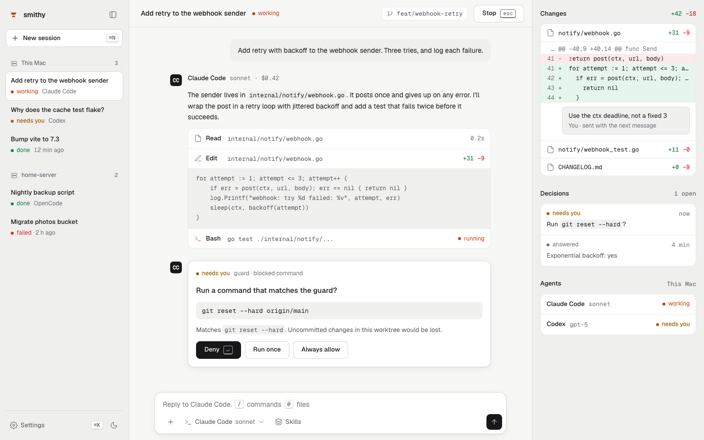
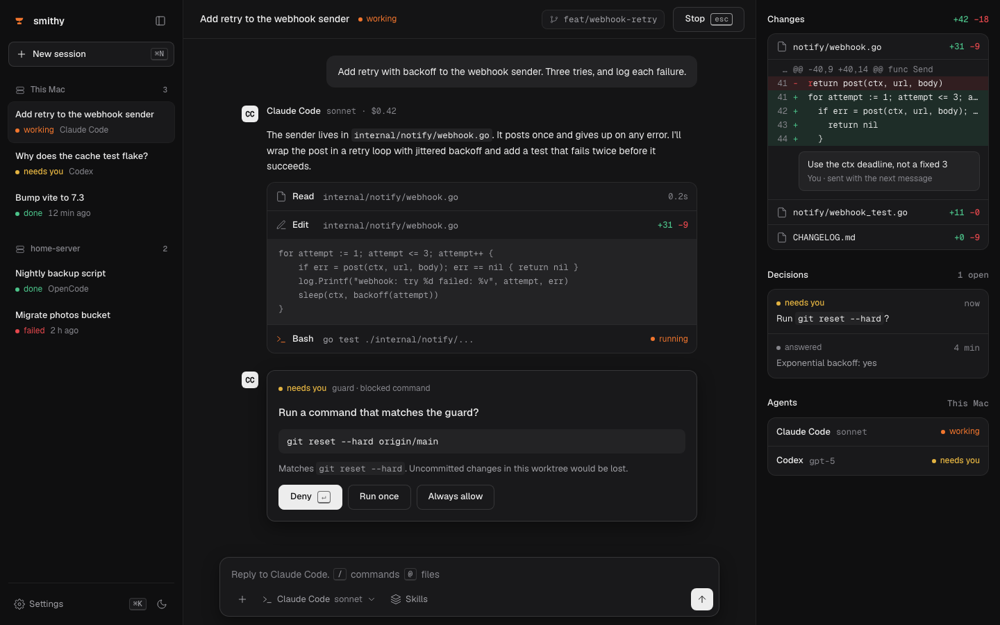
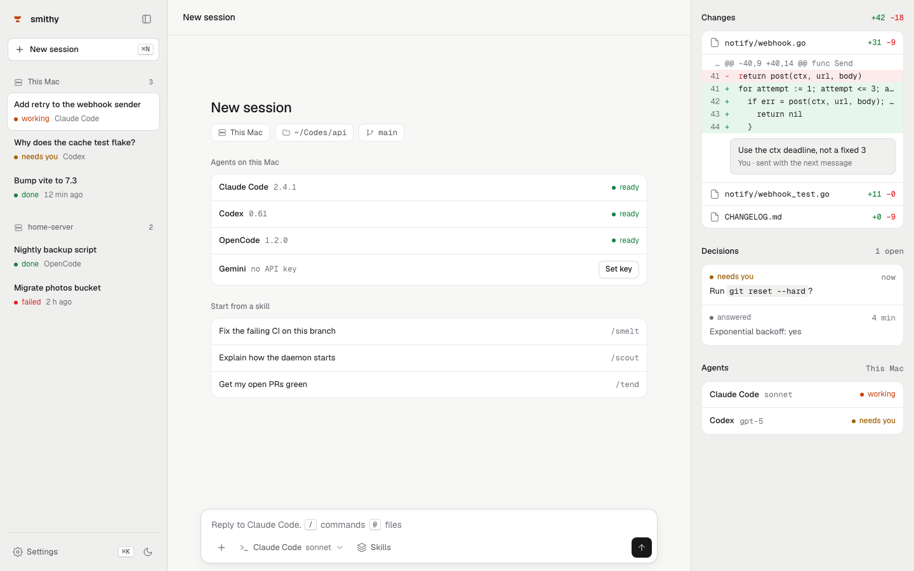
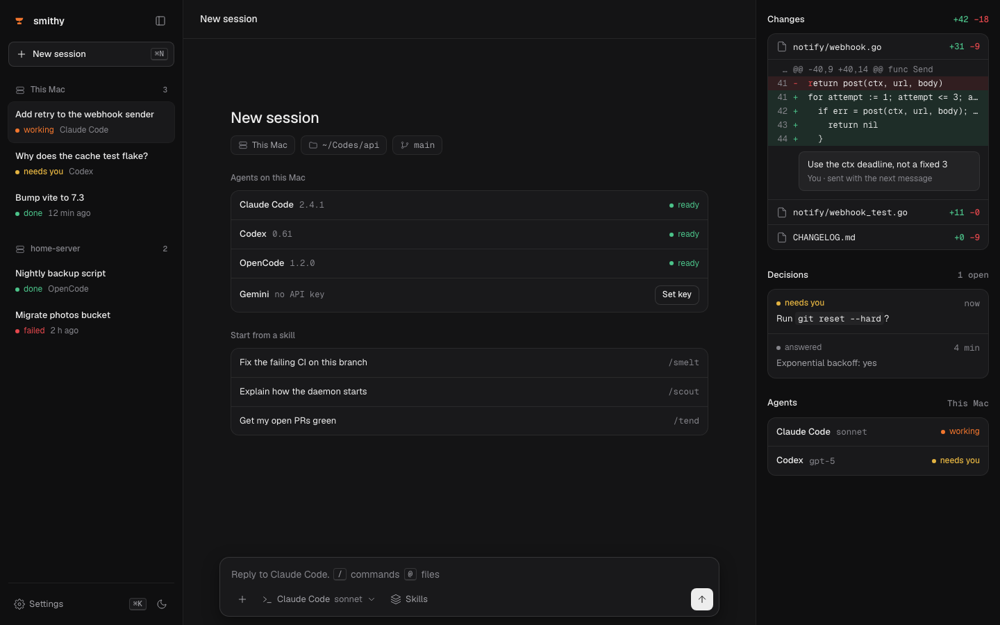
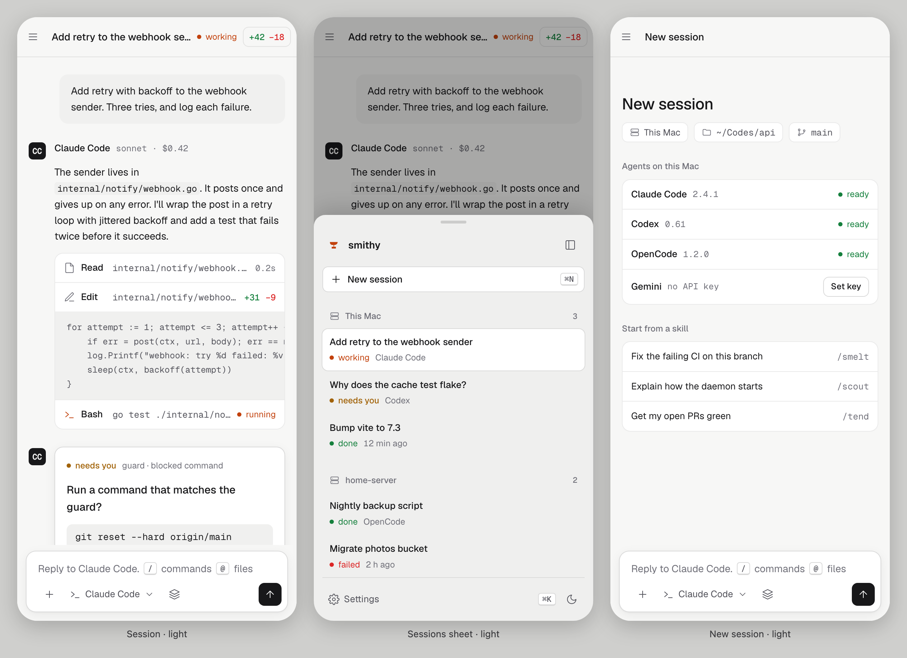
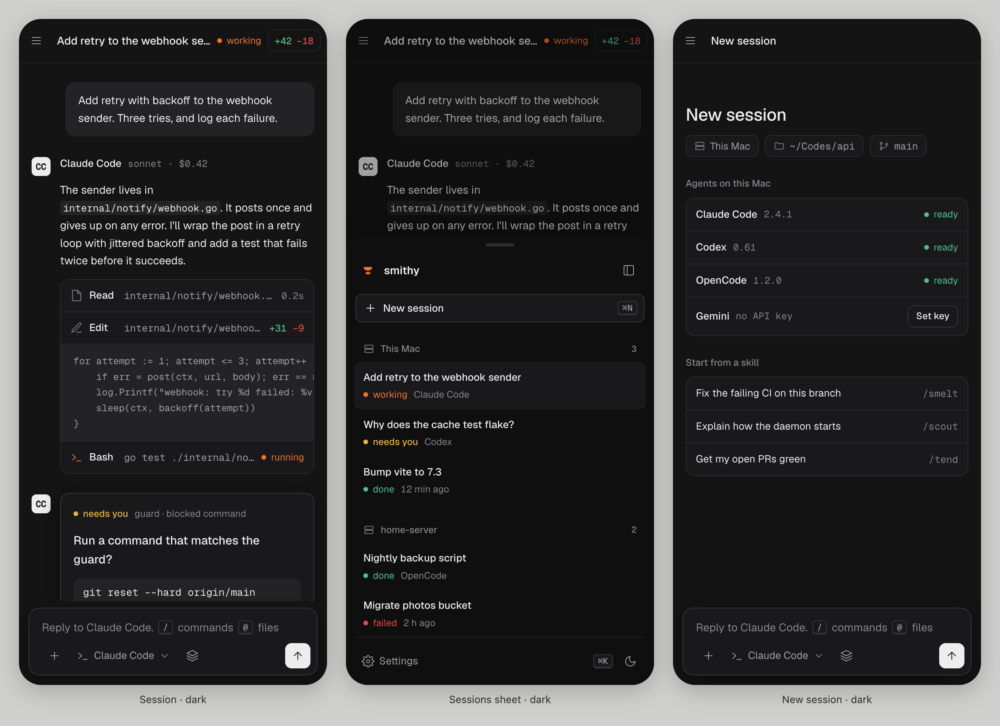

# Web design pass (v0.23): Temper

Design for approval before the web screens are built (spec §5). Open `mock.html` in a browser
(`?mode=dark`, `?view=sheet`, `?view=new`); `phones.html` shows the three phone states side by side.

**Theme:** `web/src/theme/temper.css`, a Sephiro theme. Direction: a forge harness, exact and steady
with a little heat. Graphite neutral surfaces (no warm paper), Geist + Geist Mono, one ember accent shared
with the TUI's Steel for heat (running, the action that matters), amber for "needs you". Primary
buttons are ink (light) or off-white (dark). Signature: keycaps for every shortcut (`/`, `@`, ⌘K, esc,
↵). Moments: the Changes diff and the guard decision card. Status is always a dot plus a word.

**Layout (mobile-first):**
- Phone (<1024px): one column, top bar with session title, status and `+/−` changes chip; sessions
  open as a bottom sheet; composer pinned with safe-area insets.
- Laptop (≥1024px): sessions sidebar grouped per server (§6b) + centered 720px conversation.
- Wide (≥1280px): adds the right rail: Changes (file list, diff, inline comment sent with the next
  message), Decisions, Agents.
- Decisions (guard, permission, plan approval) render inline in the conversation and in the rail.
- New session: context tags (server, folder, branch), detected agents as ready/missing rows (§3), skill starters.

**Grounded in** the v0.23 research (`research.md` §3): Claude Code on the web (sidebar, Changes card
with inline comments), Jules (plan approve), OpenCode web (same server, QR pairing), Conductor and
Sculptor (all agents visible at a glance). Traits taken: sessions left, conversation center,
changes right, one composer with `/`, needs-you status loud.

| | Light | Dark |
|---|---|---|
| Desktop 1440 |  |  |
| New session |  |  |
| Phone 390 |  |  |
