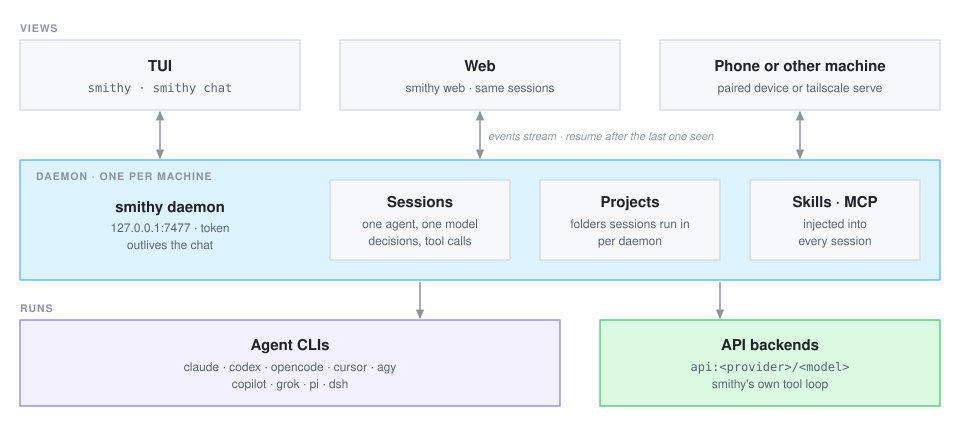

# Chat and TUI

`smithy` opens a chat with any agent CLI. A local daemon runs the sessions; the TUI and the web
are two views of it. For the agent CLIs it can drive, see [Harnesses](harnesses.md).



```bash
smithy                 # the chat (starts a background daemon if none runs)
smithy web             # the same daemon in a browser
smithy welcome         # the first-run walk
smithy stop            # stop the background daemon
smithy chat --session <id>   # open one session directly
```

The daemon outlives the chat. It exits after `daemon.idle_exit` (default 30m) with no clients
and no running work, or on `smithy stop`. `smithy chat --standalone` runs a private daemon that
stops with the chat. Where the terminal supports it (OSC 7577), a restarted terminal reopens the
chat on the same server and session.

## Layout

A tab strip on top lists this folder's sessions (`+` starts one). On wide terminals a right
sidebar shows the session's title, the context used and its share of the model's window, spend
and linked PRs; `/sidebar` toggles it. Tool calls and thoughts fold into one line such as
"+ 2 commands, 1 thought" that opens on enter or a click; a dim agent · model · time · tok/s line
sits under each answer. An agent's question opens as a card: numbered options, your own words
under Other, several picks when the agent asks for them. A `!cmd` shows as its own block: the
command, ok or exit N, how long it took and the output, folded after 20 lines.

## Keys

| Key | What it does |
|---|---|
| `enter` | send |
| `shift+enter`, `alt+enter`, `ctrl+j` | new line |
| `/` | every command |
| `@` | attach a file from this folder |
| `tab` | agents and sessions (`a`: every project) |
| `ctrl+k` | palette; `ctrl+k` and `ctrl+l` also redraw the screen |
| `ctrl+l` | agent and model |
| `ctrl+o` | transcript mode: minimal, expandable, verbose |
| `pgup` `pgdn`, `ctrl+u` `ctrl+d`, wheel | scroll; `home` and `end` jump |
| click | open a tool block or a folded line |
| `1`-`9`, arrows, `enter` | answer the question card; `space` picks several, `esc` later |
| `!cmd` | run a shell command in the session folder |
| `ctrl+v` | attach a clipboard image |
| `esc` | clear the input or close a modal |
| `?` | every key and command |
| `ctrl+c` | quit |

## Commands

| Command | What it does |
|---|---|
| `/new` | start a new session; your next message opens it |
| `/sessions` | agents and sessions: open, stop, see what waits on you |
| `/agent [name]` | the agent new sessions start with |
| `/model [name]` | the model of the open session, else new sessions |
| `/effort [off\|low\|medium…]` | reasoning effort: the open session's, else the next session's (`agent.effort`) |
| `/goal [text\|clear]` | pin a goal on the open session; the daemon continues it until the agent ends a reply with `GOAL MET: <evidence>` or `GOAL BLOCKED: <question>`, or a cap (`session.goal_max_turns`, `session.goal_max_cost`) stops it |
| `/skills` | skills and MCP injected into every session |
| `/name` or `$name` | run an installed skill on the rest of the line |
| `/theme [steel\|frost\|plum\|moss\|dune\|dusk\|rose]` | color theme, shared with the web (`ui.theme`) |
| `/mode [minimal\|expandable\|verbose]` | how much of each turn the transcript shows |
| `/stop` | stop the open session's turn |
| `/ask [question]` | a sample question on the card, to try how decisions work |
| `/answer [text]` | open the question waiting on you, or answer it in your words |
| `/refine <rough prompt>` | the refine skill: a few questions, then a structured prompt to copy or start a session with |
| `/connect` | which daemon this chat talks to |
| `/web` | open the web UI |
| `/remote` | reach this daemon from your phone or another machine |
| `/log` | daemon events kept out of the transcript |
| `/set <key> <value>`, `/unset <key>` | change a setting (same as `smithy config set`) |
| `/keys`, `/key rm <service>` | list or remove stored API keys |
| `/serve [on\|off]` | serve mode; off launches nothing new |
| `/tend` | the PRs the daemon tends and their state |
| `/doctor` | `smithy doctor` on the daemon's machine, in a modal: problems with their fix first, then things worth a look, then what is fine |
| `/prompt` | the system prompt file (`~/.smithy/prompt.md`) and whether it replaces the default |
| `/usage` | tokens in, out and cached, and cost: this session, today, 7 days, all time, per agent and model |
| `/channels [test]` | chat connectors' notifications and chat channels; `test` sends to each |
| `/board [task dir]` | task files by status: move with left/right, open a file or its PR |
| `/sidebar` | show or hide the right sidebar |
| `/links [TK-123\|#12\|PR url]` | this session's PRs and issues, live; with a ref, link it |
| `/workflows`, `/schedules` | run workflows and watch them live; turn schedules on or off ([workflows.md](workflows.md)) |
| `/run <workflow> [input=value]…` | run a workflow now |
| `/welcome` | walk the first-run steps again |
| `/setup` | every agent, ready or missing, with its fix |
| `/help` | keys and commands |
| `/agents`, `/decisions`, `/bench`, `/settings` | web only: open that page of the web UI |
| `/detach` | quit and leave the daemon running |
| `/quit` | leave; a background daemon keeps running |

## Projects

A session runs in one project folder. `tab` lists the sessions of this folder; `a` shows every
project. A new session asks which project it works in.

## Settings

| Setting | Default | Effect |
|---|---|---|
| `ui.theme` | `steel` | `steel`, `frost`, `plum`, `moss`, `dune`, `dusk` or `rose`, for TUI and web |
| `ui.reduce_motion` | `false` | `true` stills the animations |
| `ui.splash` | `true` | `false` skips the opening animation |
| `daemon.idle_exit` | `30m` | how long an idle daemon waits before it exits |

Set them with `/set` or `smithy config set`. Every setting: [settings.md](settings.md).

## Web

`smithy web` prints the link to the web UI the daemon serves and `smithy web open` opens it; the
token rides in the URL fragment. Behind `tailscale serve`, open `https://<machine>.<tailnet>.ts.net/`.
The web does what the TUI does:

- **New session**: pick a project (added with a folder browser on the daemon's machine), the
  agent, its model and effort.
- **Session**: the chat, with `!cmd`, pasted or dropped images, `/ask` and every TUI command
  under `/`; `ctrl+k` opens the palette. Shell commands and questions render as in the TUI.
- **Decisions** (`2`), **Agents** (`3`: sessions, ready and missing agents, cost, tokens, tok/s
  and runs per hour as text charts), **Board** (`4`: local task files by status; moving a card
  updates the file), **Bench** (`5`: runs, comparisons, start a run), **Settings** (`6`),
  **Workflows** (`7`) and **Schedules** (`8`) ([workflows.md](workflows.md)).
- The session side panel shows the session's linked PRs and issues, live; the Agents page has a
  Work section with them. The composer takes `/goal`, `/usage`, `/effort` (also before a session)
  and `/refine`.
- A side panel on every page shows running agents, what waits on you and the cost.

Settings in the web match the TUI's: every setting with a typed control, API keys, serve on/off,
doctor, the theme (`ui.theme`) and saved servers (add one with a pairing code, or switch).

Install it as an app: in Chrome use Install, on iOS Safari use Add to Home Screen. The page shell
opens offline; the data needs the daemon.

## Other machines

`smithy chat <url>` or `--server <name>` connects to another daemon. `/remote` shows how to reach
this one. Saved servers: `smithy servers`.
